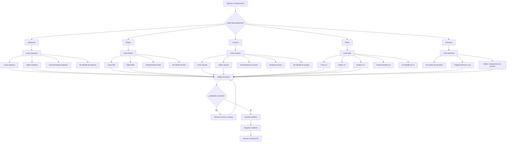

# Flujo General de Organización

**Objetivo:** Visualizar la arquitectura global del módulo de Organización y las rutas de acción principales para Empresas, Filiales, Usuarios, Roles y Permisos.

## Diagrama de Flujo General

