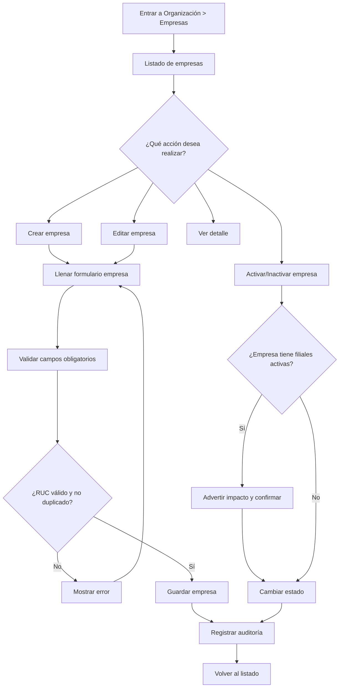

# Flujo de Empresas

**Objetivo:** Gestionar la razón social legal base del sistema.

## Reglas de Negocio
* Una empresa puede tener muchas filiales.
* Una filial pertenece a una sola empresa activa.
* **No se debe eliminar físicamente** una empresa si ya tiene movimientos; solo se inactiva (Soft Delete).

## Diagrama de Flujo

